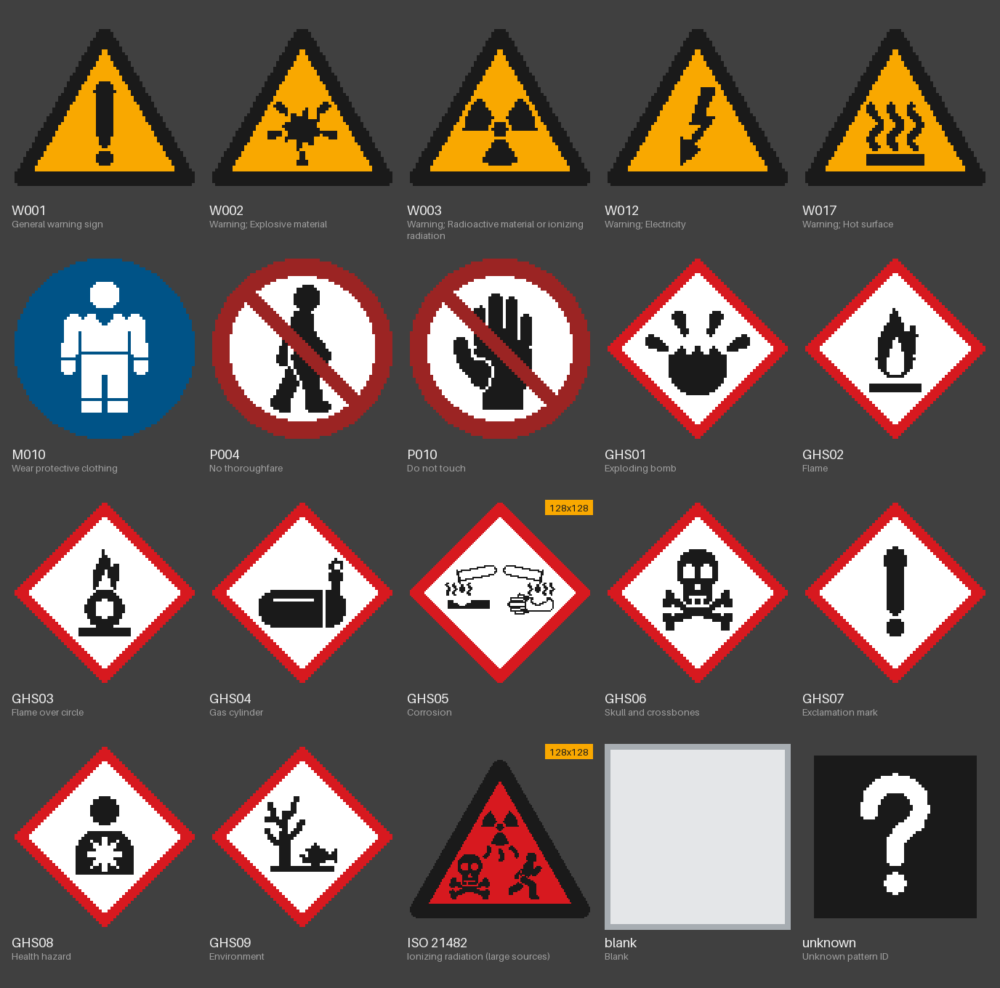

# Safety Signs

[日本語](README.md)

A Minecraft mod that adds decorative warning signs inspired by ISO 7010 safety signs.
Put a "radioactive material" sign around your reactor or an "electricity" sign on your switchboard. The signs are purely decorative and have no gameplay effect.

> **This is an unofficial mod and is not affiliated with ISO (the International Organization for Standardization).** The pictograms were drawn for this mod with ISO 7010 as a reference.

## Download

- Get `safetysigns-1.12.2-<version>.jar` from [GitHub Releases](https://github.com/zeusisgood/safetysigns/releases) and put it in your `mods` folder.
- **Required on both the client and the server.** Only the same minor version can connect (e.g. 1.0.x with 1.0.x).

## Supported versions

| Item | Version |
|---|---|
| Minecraft | Java Edition 1.12.2 |
| Mod loader | Forge (developed and tested on 14.23.5.2860) |
| Dependencies | None |

## Signs

| Item | Size | Placement |
|---|---|---|
| Safety Sign (Wall, 1x1) | 1 block | A thin plate facing the player who placed it |
| Safety Sign (Wall, 2x2) | 2 wide × 2 tall | The clicked spot becomes the bottom-left; it extends right and up. All 4 spaces must be free |
| Safety Sign (Pole) | 3 tall | Placed on a floor (top face of a block). The bottom two are the pole, the top is a 1x1 sign |

- Signs face one of 4 directions, toward the player who placed them.
- If any part of a 2x2 or pole sign is broken, the whole sign is removed and drops a single item.
- The plate is cut out to the shape of the pictogram (triangle or circle).

## Controls

| Action | Result |
|---|---|
| Right-click with a sign item | Places it, keeping the item's pictogram and settings |
| Right-click a placed sign (empty hand, or holding anything but a sign item) | Opens the pictogram picker |
| Sneak + right-click a placed sign while holding a sign item | Copies the sign's pictogram and settings to the held item (type and size may differ) |
| Pick block (middle click) | Gives the item with the pictogram (creative) |
| Break the sign | Drops an item that keeps the pictogram and settings |
| Put a single sign item in the crafting grid | Gives a blank item of the same kind |

### Pictogram picker

- Use the tabs at the top (Warning, Prohibition, Mandatory action, Safe condition, Fire equipment) and pick a pictogram from the grid. **It is applied to the sign right away** (no confirm button).
- The search box filters by code (`W003` etc.), English name, Japanese name and keywords, across all categories.
- "Reset to blank" removes the pictogram.
- Each sign has the following settings (also applied right away).

| Setting | Meaning | Default |
|---|---|---|
| Cutout | ON: plate in the shape of the pictogram / OFF: square plate (light metal around the pictogram) | ON |
| Back | Silver: plain metal / Pattern: the same pictogram on the back, readable from behind | Silver |
| Night glow | ON: only the front pictogram is drawn at full brightness (does not light the area) / OFF: uses the surrounding light | ON |

## Pictograms

| Code | Category | Name |
|---|---|---|
| W001 | Warning | General warning sign |
| W002 | Warning | Explosive material |
| W003 | Warning | Radioactive material or ionizing radiation |
| W012 | Warning | Electricity |
| W017 | Warning | Hot surface |
| M010 | Mandatory action | Wear protective clothing |
| P004 | Prohibition | No thoroughfare |
| P010 | Prohibition | Do not touch |

Resource packs can add or replace pictograms (see [doc/resourcepack.md](doc/resourcepack.md), in Japanese). Players without the pack see a "?" pictogram.

## Recipes

All recipes are shapeless.

| Result | Ingredients | Count |
|---|---|---|
| Safety Sign (Wall, 1x1) | 1 Sign (wooden) + 1 Iron Ingot | 1 |
| Safety Sign (Wall, 2x2) | 4 Signs (wooden) + 1 Iron Ingot | 1 |
| Safety Sign (Pole) | 3 Signs (wooden) + 1 Iron Ingot | 1 |
| Reset to blank | A single sign item | 1 blank item of the same kind |

- The iron accepts the ore dictionary entries `ingotIron` and `plateIron` (iron ingots and iron plates from other mods).
- The wooden sign is the vanilla sign.
- Crafted signs are blank with default settings (cutout ON, back silver, night glow ON).

## License

MIT (code and textures). See [LICENSE](LICENSE).

## For developers

- Changelog: [CHANGELOG.md](CHANGELOG.md) (in Japanese)
- Design and docs are in `doc/` (in Japanese).
- Build: `./gradlew build` with JDK 8 → `build/libs/safetysigns-1.12.2-<version>.jar`
