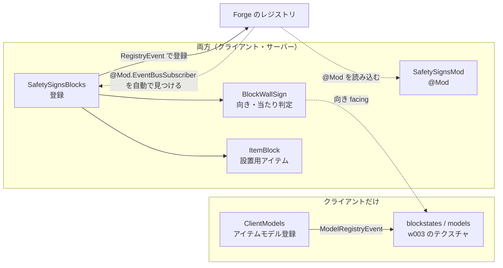
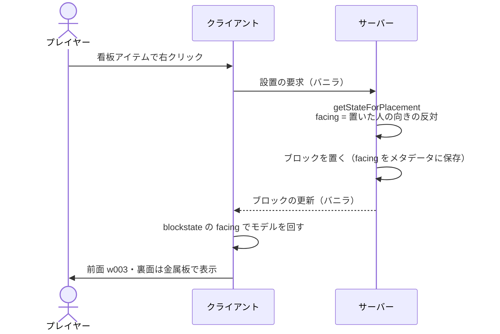

# 仕組み（アーキテクチャ）

現在の実装（0.1.0、仕様書「9. 作業の順番」の 1 まで）の全体構成と主要な流れ。
仕組みを変えたら、同じ PR でこの文書と図を直す。

## 全体構成

- クライアントとサーバーの両方に Mod が必要（`@Mod` の `acceptableRemoteVersions` で同じマイナー同士だけ接続できる）。
- 0.1.0 の時点では、ブロック・アイテムを登録するだけで、独自の通信・TileEntity・設定はない。
- 壁掛け看板 1×1 の図柄は `safetysigns:w003` に固定。見た目はブロックモデル（JSON）の前面テクスチャだけで決まる。

| パッケージ / ファイル | 役割 | 動く場所 |
|---|---|---|
| `SafetySignsMod` | `@Mod` 本体。mod ID・版・接続できる版の範囲 | 両方 |
| `block/SafetySignsBlocks` | ブロックと設置用アイテム（`ItemBlock`）の登録（`@Mod.EventBusSubscriber` で Forge が自動で見つける） | 両方 |
| `block/BlockWallSign` | 壁掛け看板 1×1。向き（4 方向）・当たり判定（厚さ 1 ピクセル） | 両方 |
| `client/ClientModels` | アイテムのモデルの登録 | クライアントだけ |
| `assets/safetysigns/blockstates`・`models` | 向きごとのモデルの回転、前面（図柄）と裏面・側面（金属板）のテクスチャ | クライアントだけ |

## 主要な流れ（設置と表示）

1. プレイヤーが看板アイテムで右クリックすると、`ItemBlock` がクリックした面の隣に設置する。
2. `BlockWallSign.getStateForPlacement` が、置いた人の向きの反対（面が置いた人のほうを向く）を `facing` にする。
3. ブロックの状態（`facing` はメタデータ 0〜3 で保存）がクライアントへ同期される（バニラの仕組み）。
4. クライアントは blockstate の `facing` に合わせてモデルを回し、前面に w003、裏面・側面に金属板のテクスチャを描く。

## 今後（仕様書「9. 作業の順番」の 2 以降）

- 図柄 ID を TileEntity の NBT に文字列で持ち、定義ファイル・GUI で選べるようにする（[ADR 0001](adr/0001-store-sign-pattern-as-string-id.md)）。そのとき、前面の図柄はブロックモデルの固定テクスチャから、図柄 ID に応じた描画に置き換える。
