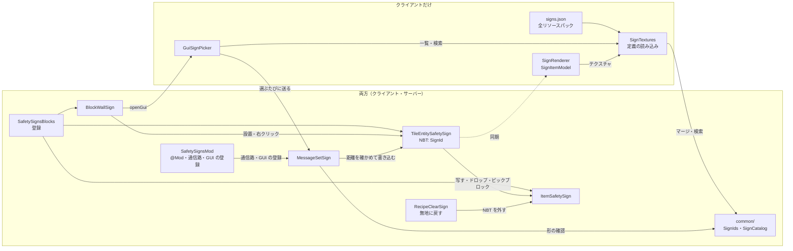

# 仕組み（アーキテクチャ）

現在の実装（0.2.1、仕様書「9. 作業の順番」の 3 まで）の全体構成と主要な流れ。
仕組みを変えたら、同じ PR でこの文書と図を直す。条件付きの図は [`diagrams/`](diagrams/) にある。

## 全体構成

- クライアントとサーバーの両方に Mod が必要（`@Mod` の `acceptableRemoteVersions` で同じマイナー同士だけ接続できる）。
- 看板の図柄は、TileEntity とアイテムの NBT に**図柄 ID の文字列**で持つ（[ADR 0001](adr/0001-store-sign-pattern-as-string-id.md)）。
- 図柄の一覧（定義ファイル）はクライアントだけが読む。サーバーは ID の文字列を保存・同期し、届いた ID の形と距離を確かめるだけ（[ADR 0002](adr/0002-load-sign-definitions-on-texture-stitch.md)）。
- 見た目: ブロックモデル（JSON）は無地の板。図柄は TileEntity の描画（`SignRenderer`）が前面の 0.003 ブロック手前に重ねる。アイテムは `SignItemModel` が NBT に合わせて「無地 + 図柄」の 2 枚重ねのモデルに差し替える。

| パッケージ / ファイル | 役割 | 動く場所 |
|---|---|---|
| `SafetySignsMod` | `@Mod` 本体。mod ID・版・接続できる版の範囲。通信路と GUI の登録 | 両方 |
| `SafetySignsGuiHandler` | GUI の番号 → 画面（図柄選択）。コンテナがないのでサーバーは何も開かない | 両方（画面はクライアント） |
| `block/SafetySignsBlocks` | ブロック・アイテム・TileEntity（`safetysigns:sign`）の登録 | 両方 |
| `block/BlockWallSign` | 壁掛け看板 1×1。向き・当たり判定。設置時にアイテムの図柄を引き継ぐ。右クリックで GUI。壊したとき・ピックブロックで図柄入りのアイテムを返す | 両方 |
| `tile/TileEntitySafetySign` | 図柄 ID を持つ。保存とクライアントへの同期 | 両方 |
| `item/ItemSafetySign`・`item/SignNbt` | 看板アイテム（ツールチップに図柄）。スニーク右クリックで看板の図柄を写す。NBT のキー `SignId` の読み書き | 両方 |
| `recipe/RecipeClearSign`・`recipe/SafetySignsRecipes` | 看板アイテム 1 個だけで無地に戻すレシピ（`safetysigns:clear_sign`）とその登録 | 両方 |
| `network/MessageSetSign` | クライアント → サーバー: 図柄を変える。サーバーが形・距離・場所を確かめる | 両方 |
| `common/` | Minecraft に依存しない計算: 図柄 ID の形（`SignIds`）、定義ファイルの読み取り（`SignDefinitionParser`）、マージと検索（`SignCatalog`） | 両方（使うのは主にクライアント） |
| `client/SignTextures` | 定義ファイルを全パックから読んでマージし、図柄のテクスチャを登録する | クライアントだけ |
| `client/SignRenderer`・`client/SignItemModel`・`client/ClientModels` | 看板の前面の図柄の描画、アイテムのモデル、その登録 | クライアントだけ |
| `client/gui/GuiSignPicker` | 図柄選択の GUI（タブ・グリッド・プレビュー・検索・無地に戻す） | クライアントだけ |
| `assets/<namespace>/safetysigns/signs.json` | 図柄の定義ファイル（形は [`resourcepack.md`](resourcepack.md)） | クライアントだけ |

## 主要な流れ（図柄を選ぶ）

1. 看板アイテム以外を持って（素手でもよい）看板を右クリックすると、クライアントが `GuiSignPicker` を開く（サーバーは何も開かない）。
2. GUI は `SignTextures` の一覧（全パックの定義をマージしたもの）を表示する。検索は全カテゴリ横断。
3. 図柄をクリックするたびに、`MessageSetSign`（位置・図柄 ID、無地なら ID なし）をサーバーへ送る。
4. サーバーは、ID の形（`<namespace>:<名前>`、64 文字まで）・看板まで 8 ブロック以内か・いじってよい場所（スポーン保護の外）かを確かめ、TileEntity に書き込む。図柄の一覧は見ない。
5. TileEntity の変更が、近くのクライアントへ同期される（バニラの TileEntity の更新）。
6. クライアントは `SignRenderer` で前面に図柄を描く。一覧にない ID は「?」で描き、ID は消さない。

## 設置・コピー・壊す

右クリックの分岐（GUI・コピー・設置）は [`diagrams/right-click.md`](diagrams/right-click.md) に図がある。

- 看板アイテムで右クリックすると、`ItemBlock` が設置し、`BlockWallSign.onBlockPlacedBy` がアイテムの `SignId`（形の正しいものだけ）を TileEntity に写す。向きは置いた人の向きの反対。
- 看板アイテムを持って看板を右クリックしたときは GUI を開かず、そのまま隣に設置する。
- 看板アイテムを持ってスニークし、看板を右クリックすると、`ItemSafetySign.onItemUse` が看板の図柄を手のアイテムに写す（設置しない。種類・サイズは違ってよい。スタックはまとめて写す）。スニーク中はバニラが `onBlockActivated` を呼ばないので、ブロックではなくアイテムの側で扱う（[ADR 0003](adr/0003-handle-copy-and-drops-on-the-item-side.md)）。書き換えはサーバーだけで、手のアイテムはバニラの同期で届く。
- ピックブロックは `BlockWallSign.getPickBlock` が図柄入りのアイテムを返す（クライアントの TileEntity の図柄を使う）。クリエイティブの Ctrl + ピックブロックで付く `BlockEntityTag` は、OP 以外が置いたときは読ませない（`onlyOpsCanSetNbt`。形を確かめない ID が TileEntity に入るのを防ぐ）。
- 壊すと、図柄を保持したアイテムが 1 個落ちる（一覧にない ID もそのまま）。プレイヤーが壊すときは `removedByPlayer` でブロックを消さずに残し、`getDrops` で TileEntity の図柄を読んでから `harvestBlock` で消す。クリエイティブではバニラどおり落とさない。爆発では、バニラが消す前にドロップを作るのでそのまま読める。
- 看板アイテム 1 個だけをクラフト枠に入れると、`RecipeClearSign` が同じアイテムの無地（NBT なし）を返す。もともと NBT のないアイテムでは何も出さない。レシピ本には出さない。
- 図柄は誰でも変えられる（仕様書 4。ロック機能は後回し）。アドベンチャーモードでも変えられる。弾くのは観戦者と、スポーン保護の内側だけ。

## NBT

| 場所 | キー | 値 |
|---|---|---|
| TileEntity（`safetysigns:sign`） | `SignId` | 図柄 ID の文字列。無地ならキーなし |
| アイテム（タグの直下） | `SignId` | 同上 |

キー名・TileEntity の登録名は既存のワールドが参照するので変えない。
