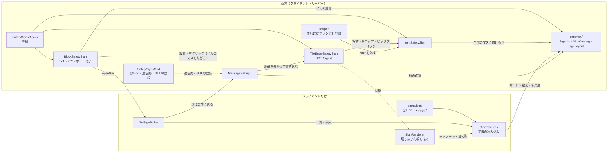
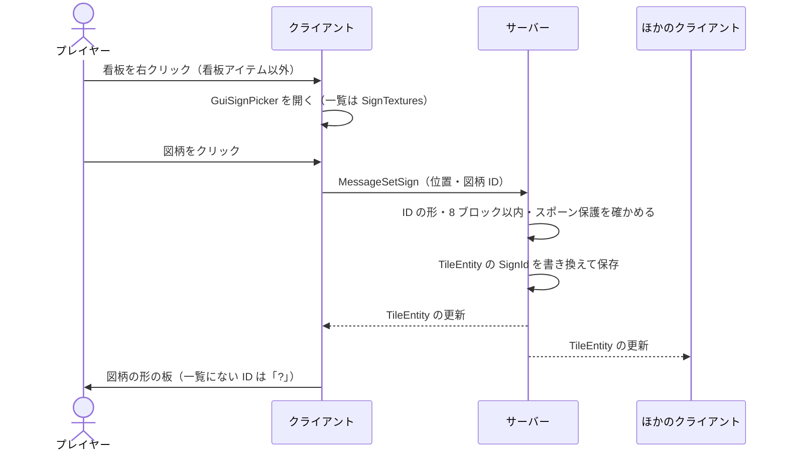

# 仕組み（アーキテクチャ）

現在の実装（0.4.0、仕様書「9. 作業の順番」の 5 まで）の全体構成と主要な流れ。
仕組みを変えたら、同じ PR でこの文書と図を直す。条件付きの図は [`diagrams/`](diagrams/) にある。

## 全体構成

- クライアントとサーバーの両方に Mod が必要（`@Mod` の `acceptableRemoteVersions` で同じマイナー同士だけ接続できる）。
- 看板の図柄は、TileEntity とアイテムの NBT に**図柄 ID の文字列**で持つ（[ADR 0001](adr/0001-store-sign-pattern-as-string-id.md)）。
- 図柄の一覧（定義ファイル）はクライアントだけが読む。サーバーは ID の文字列を保存・同期し、届いた ID の形と距離を確かめるだけ（[ADR 0002](adr/0002-load-sign-definitions-on-texture-stitch.md)）。
- 看板は 1 マス以上を使う（壁掛け 1×1・2×2、ポール付き）。図柄は代表のマス（正面から見て左下。ポール付きは最下段の支柱）の TileEntity だけが持ち、ほかのマスは部品の番号だけを状態に持つ（[ADR 0004](adr/0004-multiblock-signs-with-a-representative-cell.md)、[ADR 0005](adr/0005-pole-sign-keeps-the-pattern-in-the-pole-cell.md)、[`diagrams/multiblock.md`](diagrams/multiblock.md)）。
- 見た目: 看板の板は、代表のマスの TileEntity の描画（`SignRenderer`）が、図柄を描く面（ブロックの `getFaceRow`・`getFaceZ`。壁掛けは看板全体、ポール付きは最上段の板）に、図柄のテクスチャの形に切り抜いて描く（表は図柄、裏と縁は灰色。形は `common/SignOutline` がテクスチャのアルファから作る。[ADR 0006](adr/0006-draw-the-plate-cut-to-the-pattern-shape.md)）。ブロックモデル（JSON）は板を持たない（壁掛けは何も描かない。ポール付きは支柱と固定金具）。アイテムは `SignItemModel` が NBT に合わせて図柄のテクスチャ 1 枚のモデルに差し替える。

| パッケージ / ファイル | 役割 | 動く場所 |
|---|---|---|
| `SafetySignsMod` | `@Mod` 本体。mod ID・版・接続できる版の範囲。通信路と GUI の登録 | 両方 |
| `SafetySignsGuiHandler` | GUI の番号 → 画面（図柄選択）。コンテナがないのでサーバーは何も開かない | 両方（画面はクライアント） |
| `block/SafetySignsBlocks` | ブロック・アイテム・TileEntity（`safetysigns:sign`）の登録 | 両方 |
| `block/BlockSafetySign` | 看板のブロックの共通部分: 向き、代表のマスのたどり方、図柄を描く面の位置、設置時の図柄の引き継ぎ、右クリックで GUI、壊したとき・ピックブロックで図柄入りのアイテム、1 マス壊れたら全体を消す | 両方 |
| `block/BlockWallSign`・`block/BlockWallSign2x2` | 壁掛け看板 1×1・2×2（板の外形の四角の当たり判定。2×2 は部品の番号 `part` を状態に持つ） | 両方 |
| `block/BlockPoleSign` | ポール付き看板（縦 3 マス。部品 0（代表）・1 が支柱、2 が板）。床（上面）にだけ置ける。当たり判定は、支柱の段は細い柱、看板の段は板の外形の四角 | 両方 |
| `tile/TileEntitySafetySign` | 図柄 ID を持つ（代表のマスだけ）。保存とクライアントへの同期 | 両方 |
| `item/ItemSafetySign`・`item/SignNbt` | 看板アイテム（ツールチップに図柄）。複数マスの看板は全部のマスに置けるときだけ置く。スニーク右クリックで看板の図柄を写す。NBT のキー `SignId` の読み書き | 両方 |
| `recipe/RecipeClearSign`・`recipe/SafetySignsRecipes` | 看板アイテム 1 個だけで無地に戻すレシピ（`safetysigns:clear_sign`）とその登録 | 両方 |
| `network/MessageSetSign` | クライアント → サーバー: 図柄を変える。サーバーが形・距離・場所を確かめる | 両方 |
| `common/` | Minecraft に依存しない計算: 図柄 ID の形（`SignIds`）、定義ファイルの読み取り（`SignDefinitionParser`）、マージと検索（`SignCatalog`）、看板が使うマスの計算と置けるかの判定（`SignLayout`・`GridPos`）、テクスチャのアルファから切り抜いた板の形（`SignOutline`） | 両方（使うのは主にクライアント） |
| `client/SignTextures` | 定義ファイルを全パックから読んでマージし、図柄のテクスチャを登録する。テクスチャの PNG から板の形を作って取っておく | クライアントだけ |
| `client/SignRenderer`・`client/SignItemModel`・`client/ClientModels` | 看板の板（図柄の形に切り抜いた表・裏・縁）の描画、アイテムのモデル、その登録 | クライアントだけ |
| `client/gui/GuiSignPicker` | 図柄選択の GUI（タブ・グリッド・プレビュー・検索・無地に戻す） | クライアントだけ |
| `assets/<namespace>/safetysigns/signs.json` | 図柄の定義ファイル（形は [`resourcepack.md`](resourcepack.md)） | クライアントだけ |

## 主要な流れ（図柄を選ぶ）

1. 看板アイテム以外を持って（素手でもよい）看板を右クリックすると、クライアントが `GuiSignPicker` を開く（サーバーは何も開かない）。
2. GUI は `SignTextures` の一覧（全パックの定義をマージしたもの）を表示する。検索は全カテゴリ横断。
3. 図柄をクリックするたびに、`MessageSetSign`（位置・図柄 ID、無地なら ID なし）をサーバーへ送る。
4. サーバーは、ID の形（`<namespace>:<名前>`、64 文字まで）・看板まで 8 ブロック以内か・いじってよい場所（スポーン保護の外）かを確かめ、TileEntity に書き込む。図柄の一覧は見ない。
5. TileEntity の変更が、近くのクライアントへ同期される（バニラの TileEntity の更新）。
6. クライアントは `SignRenderer` で、図柄の形に切り抜いた板を描く。一覧にない ID は「?」で描き、ID は消さない。

## 設置・コピー・壊す

右クリックの分岐（GUI・コピー・設置）は [`diagrams/right-click.md`](diagrams/right-click.md) に図がある。

- 2×2・ポール付きなど複数マスの看板では、どのマスを右クリック・ピックブロックしても、`BlockSafetySign.getSignTile` が代表のマスをたどり、同じ看板として扱う。GUI は代表のマスの位置で開き、`MessageSetSign` も代表のマスへ送る。
- 複数マスの看板の設置（全部のマスに置けるときだけ）と破壊（1 マスで全体が消え、アイテムは 1 個）は [`diagrams/multiblock.md`](diagrams/multiblock.md)。
- 看板アイテムで右クリックすると、`ItemBlock` が設置し（複数マスなら `ItemSafetySign.placeBlockAt` が残りのマスも置く。ポール付きは、クリックした面が上面のときだけ置ける＝`BlockPoleSign.canPlaceBlockOnSide`）、`BlockSafetySign.onBlockPlacedBy` がアイテムの `SignId`（形の正しいものだけ）を TileEntity に写す。向きは置いた人の向きの反対。
- 看板アイテムを持って看板を右クリックしたときは GUI を開かず、そのまま隣に設置する。
- 看板アイテムを持ってスニークし、看板を右クリックすると、`ItemSafetySign.onItemUse` が看板の図柄を手のアイテムに写す（設置しない。種類・サイズは違ってよい。スタックはまとめて写す）。スニーク中はバニラが `onBlockActivated` を呼ばないので、ブロックではなくアイテムの側で扱う（[ADR 0003](adr/0003-handle-copy-and-drops-on-the-item-side.md)）。書き換えはサーバーだけで、手のアイテムはバニラの同期で届く。
- ピックブロックは `BlockSafetySign.getPickBlock` が図柄入りのアイテムを返す（クライアントの TileEntity の図柄を使う）。クリエイティブの Ctrl + ピックブロックで付く `BlockEntityTag` は、OP 以外が置いたときは読ませない（`onlyOpsCanSetNbt`。形を確かめない ID が TileEntity に入るのを防ぐ）。
- 壊すと、図柄を保持したアイテムが 1 個落ちる（一覧にない ID もそのまま）。プレイヤーが壊すときは `removedByPlayer` でブロックを消さずに残し、`getDrops` で代表のマスの TileEntity の図柄を読んでから `harvestBlock` で消す。クリエイティブではバニラどおり落とさない。爆発では、バニラが消す前にドロップを作るのでそのまま読める。
- 看板はピストンで動かない・壊れない（`getMobilityFlag` が `BLOCK`。代表のマス以外は TileEntity を持たないので明示している）。
- 描画の範囲（`getRenderBoundingBox`）は代表のマスの周り 1 マス・上へ 3 マスまで広げてある。2×2 の代表のマスやポール付きの支柱が画面の外に出ても、板が消えないように。描く距離（`getMaxRenderDistanceSquared`）は 256 ブロック。
- 看板アイテム 1 個だけをクラフト枠に入れると、`RecipeClearSign` が同じアイテムの無地（NBT なし）を返す。もともと NBT のないアイテムでは何も出さない。レシピ本には出さない。
- 図柄は誰でも変えられる（仕様書 4。ロック機能は後回し）。アドベンチャーモードでも変えられる。弾くのは観戦者と、スポーン保護の内側だけ。

## NBT

| 場所 | キー | 値 |
|---|---|---|
| TileEntity（`safetysigns:sign`） | `SignId` | 図柄 ID の文字列。無地ならキーなし |
| アイテム（タグの直下） | `SignId` | 同上 |

キー名・TileEntity の登録名は既存のワールドが参照するので変えない。

## ブロックの状態（メタデータ）

| ブロック | 状態 | メタデータ |
|---|---|---|
| `safetysigns:wall_sign_1x1` | `facing` | 向きの horizontal index（0 南・1 西・2 北・3 東） |
| `safetysigns:wall_sign_2x2` | `facing`・`part`（0 左下が代表・1 右下・2 左上・3 右上。正面から見て） | 下位 2 ビットが向き、上位 2 ビットが部品 |
| `safetysigns:pole_sign` | `facing`・`part`（0 最下段の支柱が代表・1 中段の支柱・2 最上段の板） | 下位 2 ビットが向き、上位 2 ビットが部品 |

メタデータの意味は既存のワールドが参照するので変えない。
