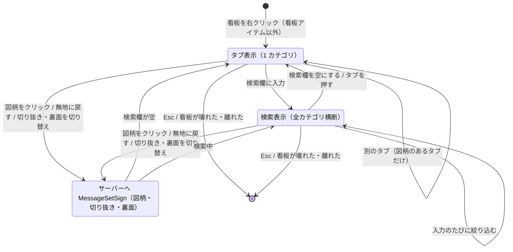

# 図柄選択の GUI の画面遷移

`client/gui/GuiSignPicker` の状態の移り変わり（0.5.0）。仕組みを変えたら、同じ PR でこの図を直す。

- 開いたとき: 今の図柄のカテゴリのタブ。無地・一覧にない図柄なら、図柄のある最初のタブ。
- 検索欄に文字があるあいだは、タブの選択を外して全カテゴリ横断で絞り込む。検索欄を空にすると、タブの表示に戻る。
- 図柄のクリック・「無地に戻す」・切り抜きと裏面の切り替えは、そのたびにサーバーへ送る（決定ボタンはない）。切り抜きのボタンは、無地のあいだ押せない（形が四角しかないため。値は保持する）。
- 看板が壊れた・8 ブロックより離れたら、毎 tick の確認で閉じる。

