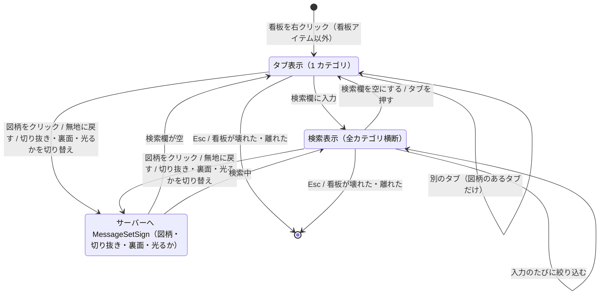

# 図柄選択の GUI の画面遷移

`client/gui/GuiSignPicker` の状態の移り変わり（0.6.0）。仕組みを変えたら、同じ PR でこの図を直す。
流れは 3 つの版で同じ。メソッドの名前は 1.12.2 のもので、1.20.1・1.21.1 の名前は [architecture.md の「版ごとの違い」](../architecture.md#版ごとの違い)。

- タブは W P M E F GHS その他の順（`SignCategory` の順）。文字の長いタブ（GHS・その他）は文字に合わせて広い。
- 開いたとき: 今の図柄のカテゴリのタブ。無地・一覧にない図柄なら、図柄のある最初のタブ。
- 検索欄に文字があるあいだは、タブの選択を外して全カテゴリ横断で絞り込む。検索欄を空にすると、タブの表示に戻る。
- 図柄のクリック・「無地に戻す」・切り抜きと裏面の切り替え・夜間に光るかの切り替え（プレビューの下）は、そのたびにサーバーへ送る（決定ボタンはない）。サーバーが書き込むと、全員に同期される。切り抜きのボタンは、無地のあいだ ON のまま押せない（形が四角しかないため。「無地に戻す」で ON に戻る）。夜間に光るかのボタンは無地でも押せ、「無地に戻す」でも値は変わらない。
- 看板が壊れた・8 ブロックより離れたら、毎 tick の確認で閉じる。

