# 図柄選択の GUI の画面遷移

`client/gui/GuiSignPicker` の状態の移り変わり（1.1.1）。仕組みを変えたら、同じ PR でこの図を直す。
流れは 3 つの版で同じ。メソッドの名前は 1.12.2 のもので、1.20.1・1.21.1 の名前は [architecture.md の「版ごとの違い」](../architecture.md#版ごとの違い)。

- タブは左端の「最近」、続いて W P M E F GHS その他の順（`SignCategory` の順）。文字の長いタブ（最近・GHS・その他）は文字に合わせて広い。
- 開いたとき: 今の図柄のカテゴリのタブ。無地・一覧にない図柄なら、図柄のある最初のタブ。「最近」から開くことはない。
- 「最近」のタブは、最近使った図柄（`RecentSignsFile`、18 個まで）のうち一覧にあるものを新しい順に出す。どれもなければ押せない。並びはタブを開いたときのままで、開いているあいだに図柄を選んでも動かない。
- 検索欄に文字があるあいだは、タブの選択を外して全カテゴリ横断で絞り込む。検索欄を空にする（右クリックでも消える）と、今の図柄のカテゴリのタブに戻る。
- 図柄のクリック・「無地に戻す」・下の段の形（切り抜き）・裏側・蓄光（夜間に光る）の切り替えは、そのたびにサーバーへ送る（決定ボタンはない）。サーバーが書き込むと、全員に同期される。図柄のクリックは、最近使った図柄にも記録する（ファイルにもそのたびに書く）。形のボタンは、無地のあいだ「標識」のまま押せない（形が四角しかないため。「無地に戻す」で「標識」に戻る）。蓄光のボタンは無地でも押せ、「無地に戻す」でも値は変わらない。
- 右上の「×」・Esc で閉じる。看板が壊れた・8 ブロックより離れたら、毎 tick の確認で閉じる。

```mermaid
stateDiagram-v2
    [*] --> Tab: 看板を右クリック（看板アイテム以外）
    Tab: タブ表示（1 カテゴリ）
    Search: 検索表示（全カテゴリ横断）
    Recent: 「最近」のタブ（新しい順）
    Tab --> Tab: 別のタブ（図柄のあるタブだけ）
    Tab --> Recent: 「最近」を押す（履歴があるときだけ）
    Recent --> Tab: カテゴリのタブを押す
    Tab --> Search: 検索欄に入力
    Recent --> Search: 検索欄に入力
    Search --> Search: 入力のたびに絞り込む
    Search --> Tab: 検索欄を空にする（右クリック） / タブを押す
    Search --> Recent: 「最近」を押す
    Tab --> Send: 図柄をクリック / 無地に戻す / 形・裏側・蓄光を切り替え
    Recent --> Send: 同上
    Search --> Send: 同上
    Send: サーバーへ MessageSetSign（図柄・切り抜き・裏面・光るか）<br/>図柄のクリックは最近使った図柄に記録
    Send --> Tab: カテゴリのタブ
    Send --> Recent: 「最近」のタブ
    Send --> Search: 検索中
    Tab --> [*]: × / Esc / 看板が壊れた・離れた
    Recent --> [*]: × / Esc / 看板が壊れた・離れた
    Search --> [*]: × / Esc / 看板が壊れた・離れた
```

