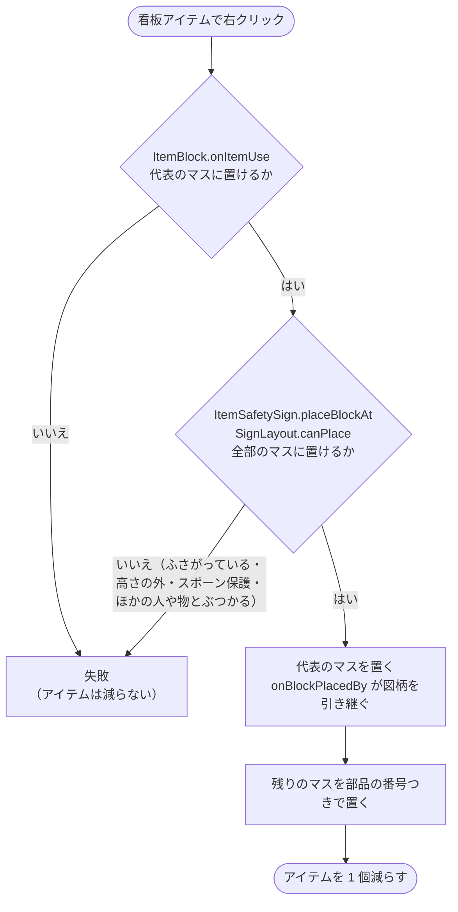
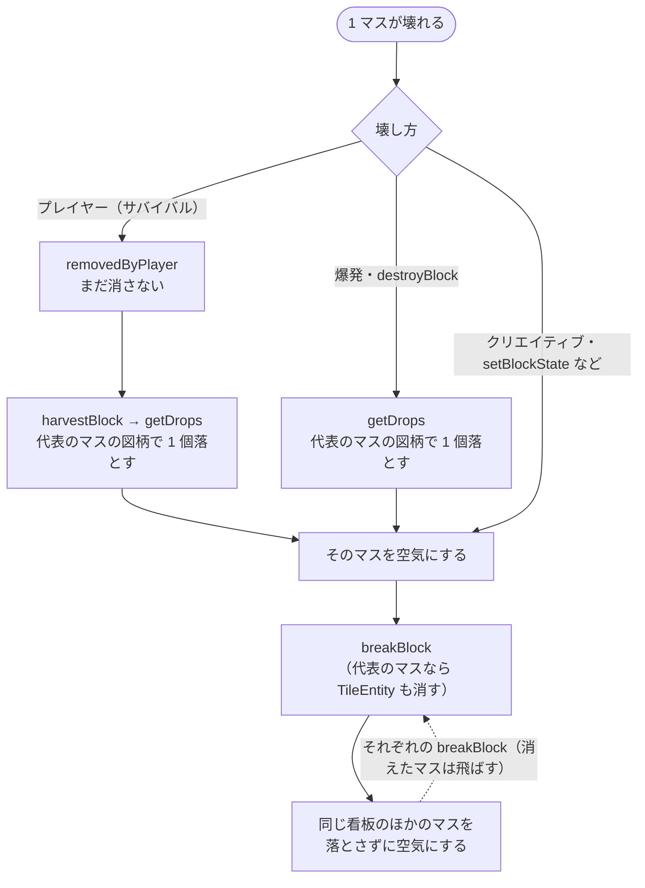

# 複数マスの看板の設置と破壊

壁掛け看板 2×2 など、複数マスを使う看板の設置と破壊の流れ（0.3.0）。仕組みを変えたら、同じ PR でこの図を直す。

- マスの並びは `common/SignLayout`。正面から見て、**代表のマス（部品 0）が左下**で、そこから右・上へ広がる。2×2 の部品は 0 左下・1 右下・2 左上・3 右上。
- 置く所（クリックした面の隣、または置き換え可能なブロック）が代表のマスになる。
- サーバーで置けなかったときは、全部のマスの今の状態をクライアントへ送り直す（クライアントが先に置いて見せたマスを消す）。
- 部品の番号はブロックの状態（`part`）に持つ。図柄 ID は代表のマスの TileEntity だけが持つ。
- どのマスからでも、`BlockSafetySign.getSignTile` が向きと部品の番号から代表のマスをたどる（GUI・コピー・ピックブロック・ドロップ）。
- 1×1 も同じ仕組みで、マスが 1 つだけの場合として扱う。

## 設置

## 破壊

- どう壊れても（プレイヤー・爆発・`/setblock`・他 Mod の `setBlockState`）、サーバーでは `breakBlock` を通る。ここで、同じ看板のほかのマスを、アイテムを落とさずに消す。
- アイテムは、壊れたマスの `getDrops` が 1 個だけ作る。図柄は代表のマスから読む。プレイヤーが壊すときは、`removedByPlayer` でブロックを残し、`harvestBlock` でドロップを作ってから消す。爆発・`destroyBlock` は、消す前にドロップを作る。
- クリエイティブで壊すとドロップは作られない（バニラどおり）。
- ピストンでは動かない・壊れない（`getMobilityFlag` が `BLOCK`）。

