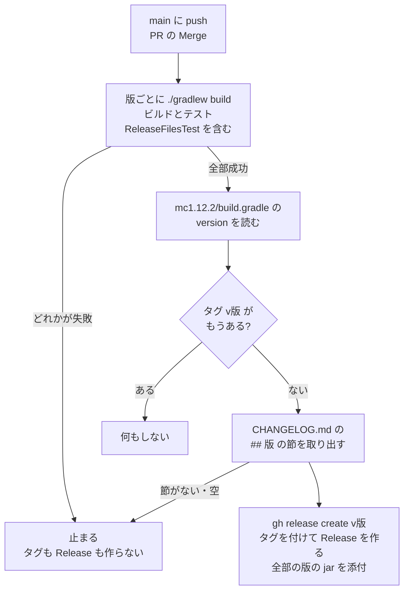

# リリースの流れ

`main` に取り込まれたときに `.github/workflows/ci.yml` の `release` ジョブが動き、版が新しければタグと GitHub Release を作る。仕組みを変えたら、同じ PR でこの図を直す。

- Minecraft の版ごとのビルド（`build (<版>)`）が全部通ったときだけ、`build` が成功し、`release` ジョブに進む。`release` ジョブは `main` への push のときだけ動く（PR では動かない）。
- 版は `mc1.12.2/build.gradle` の `version`。タグ `v<版>` がもうあれば何もしない（版を上げていない Merge・文書だけの Merge）。
- 版のずれ（各版の版の番号・`CHANGELOG.md` の最新の見出し）は `ReleaseFilesTest` で落ちるので、ふつうは PR の CI で先に見つかる。
- タグは `gh release create` が Release と一緒に、取り込んだコミットに付ける。権限は `release` ジョブの `contents: write` だけ。

