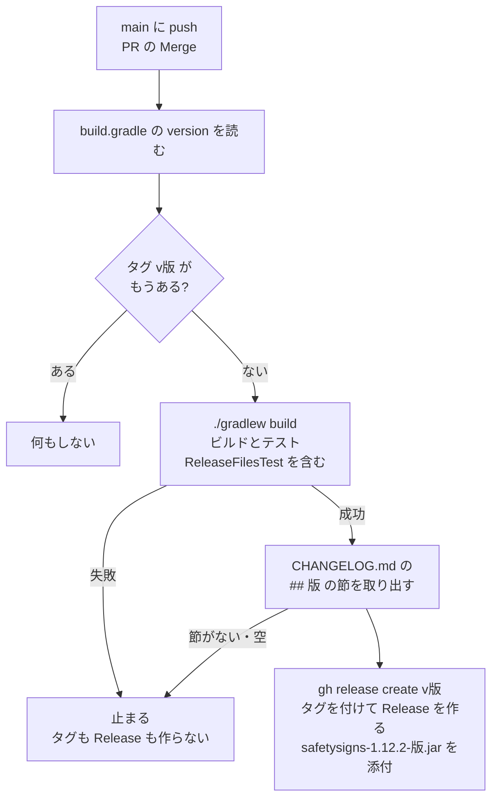

# リリースの流れ

`main` に取り込まれたときに `.github/workflows/release.yml` が動き、版が新しければタグと GitHub Release を作る。仕組みを変えたら、同じ PR でこの図を直す。

- 版は `build.gradle` の `version`。タグ `v<版>` がもうあれば何もしない（版を上げていない Merge・文書だけの Merge）。
- ビルドかテストが失敗したら、タグもリリースも作らない。版のずれ（`build.gradle`・`SafetySignsMod.VERSION`・`CHANGELOG.md` の最新の見出し）は `ReleaseFilesTest` で落ちるので、ふつうは PR の CI（`ci.yml`）で先に見つかる。
- タグは `gh release create` が Release と一緒に、取り込んだコミットに付ける。権限は `contents: write` だけ。

