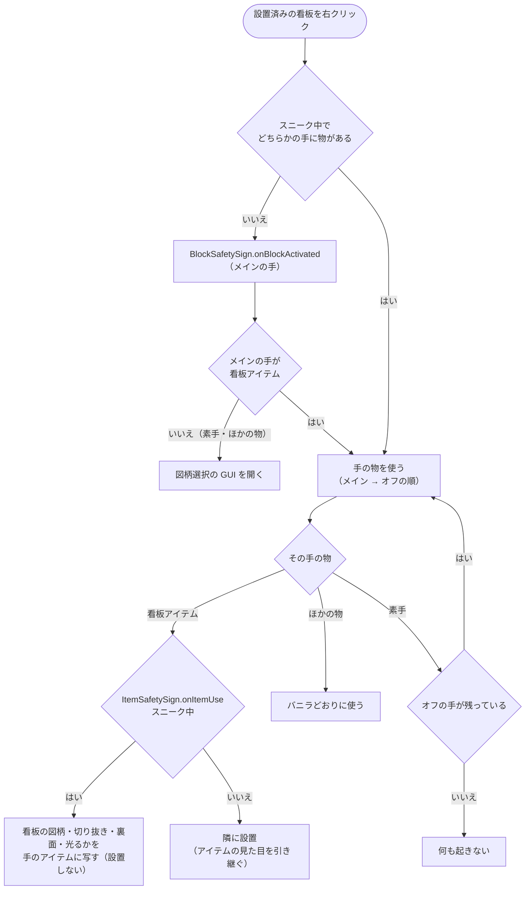

# 看板を右クリックしたときの分岐

設置済みの看板を右クリックしたときに、GUI・コピー・設置のどれになるか（0.6.0）。仕組みを変えたら、同じ PR でこの図を直す。

- 2×2・ポール付きなど複数マスの看板は、どのマスを右クリックしても、代表のマスの図柄を使う（GUI・コピー。[`multiblock.md`](multiblock.md)）。
- バニラ（Forge）は、手ごとに「ブロックを使う（`onBlockActivated`）→ 手の物を使う（`onItemUse`）」の順に試す。メインの手で何か起きたら、オフの手は試さない。
- **スニーク中**で、どちらかの手に物があると、バニラは `onBlockActivated` を呼ばない（両手とも素手なら呼ぶ）。そのため GUI は開かず、手の物を使う。
- コピーは `ItemSafetySign.onItemUse` が扱う。スニーク中に設置済みの看板を狙っていれば、その看板の見た目（図柄（無地・一覧にない ID も）・切り抜き・裏面・夜間に光るか）を手の看板アイテムに写し、設置しない。種類・サイズは違ってよい。書き換えはサーバーだけで、手のアイテムはバニラの同期でクライアントへ届く。
- ピックブロックも、図柄と一緒に切り抜き・裏面・光るかを写したアイテムを返す（`BlockSafetySign.getPickBlock`）。
- 看板アイテムを持ってスニークせずに右クリックすると、`onBlockActivated` は何もせず、看板の隣に設置する（ふつうの設置と同じ）。
- 看板アイテムがオフの手だけにあるときも同じ。メインの手が素手なら、スニークしないと GUI、スニークするとオフの手の看板アイテムに写す。
- スニーク中にほかの物（ブロックなど）を持っているときは GUI を開かず、バニラどおりにその物を使う（仕様書 4 の「看板アイテム以外 → GUI」の例外。バニラのチェストなどと同じ慣習）。

