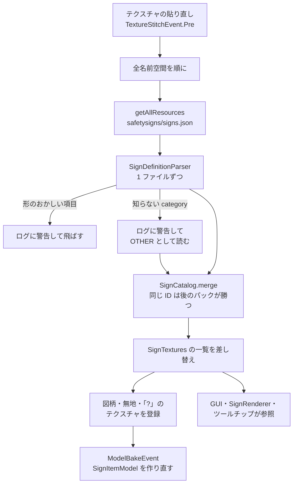
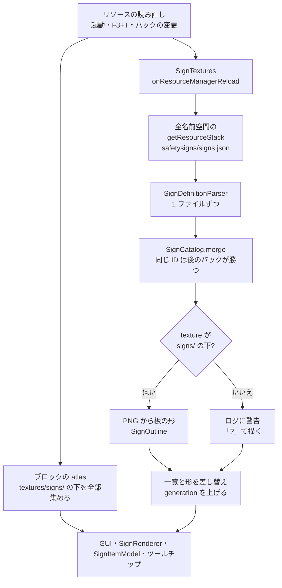

# 図柄の定義ファイルの読み込み

`client/SignTextures` が定義ファイルを読む流れ（0.2.0。1.20.1・1.21.1 は 1.1.0 から、下の「1.20.1・1.21.1」）。クライアントだけ。仕組みを変えたら、同じ PR でこの図を直す。

- ブロックのテクスチャを貼り直すとき（起動・F3+T・リソースパックの変更）に、毎回読み直す。
- 各名前空間の `assets/<namespace>/safetysigns/signs.json` を、`getAllResources` で全パックから集める（優先度の低い順）。
- 項目の ID の名前空間は、ファイルの名前空間と同じでなければ飛ばす。同じ ID は優先度の高いパックで丸ごと上書き。
- 形のおかしい項目・ファイルはログに警告を出して飛ばす（ほかの項目は使う）。`category` が知らない値なら、飛ばさずに警告を出して `OTHER`（その他のタブ）として読む（1.0.2）。
- アイテムの図柄入りモデルは、テクスチャの貼り直しのあとのモデルの作り直し（`ModelBakeEvent`）で古いものが捨てられる。

## 1.20.1・1.21.1

- 図柄のテクスチャは、ブロックの atlas が自分で集める（`assets/minecraft/atlases/blocks.json` の `directory` のソースで、全部のパック・全部の名前空間の `textures/signs/` の下）。`SignTextures` はテクスチャを登録しない。
- 定義ファイルは、リソースの読み直しのたびに読む（`RegisterClientReloadListenersEvent` に登録した `SignTextures`）。集め方（`getResourceStack`。優先度の低い順）・マージ・警告は 1.12.2 と同じ。
- 定義ファイルの texture が `signs/` の下でない図柄は、atlas に入らないので「?」で描き、ログに 1 回警告を出す（ID は消さない）。
- 読み直すたびに数を上げ（`generation`）、`SignRenderer` が取っておいた四角の並びを作り直す。

