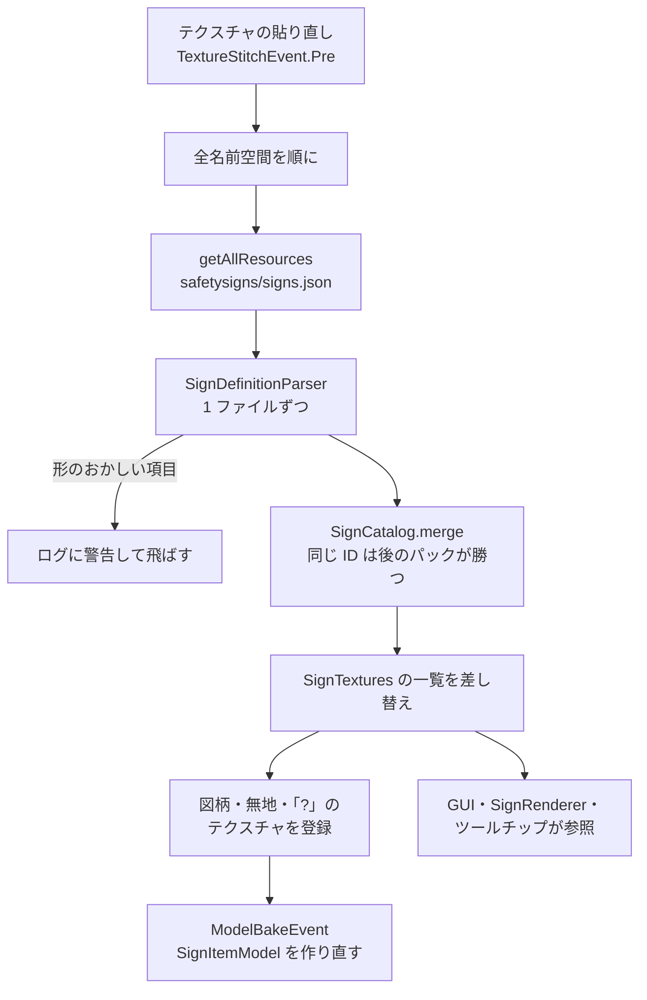

# 図柄の定義ファイルの読み込み

`client/SignTextures` が定義ファイルを読む流れ（0.2.0）。クライアントだけ。仕組みを変えたら、同じ PR でこの図を直す。

- ブロックのテクスチャを貼り直すとき（起動・F3+T・リソースパックの変更）に、毎回読み直す。
- 各名前空間の `assets/<namespace>/safetysigns/signs.json` を、`getAllResources` で全パックから集める（優先度の低い順）。
- 項目の ID の名前空間は、ファイルの名前空間と同じでなければ飛ばす。同じ ID は優先度の高いパックで丸ごと上書き。
- 形のおかしい項目・ファイルはログに警告を出して飛ばす（ほかの項目は使う）。
- アイテムの図柄入りモデルは、テクスチャの貼り直しのあとのモデルの作り直し（`ModelBakeEvent`）で古いものが捨てられる。

