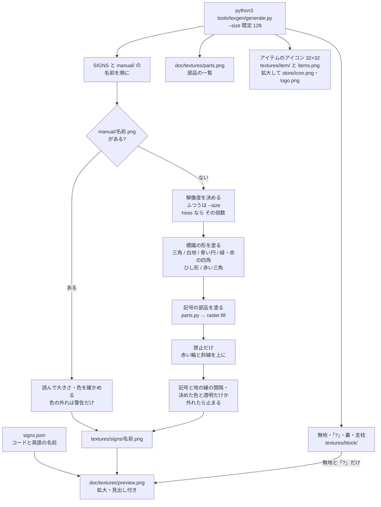

# テクスチャの生成

`tools/texgen/generate.py` が看板のテクスチャと一覧画像を作る流れ（1.0.5）。手元で流して、出力の PNG をコミットする（ビルドには Python を持ち込まない）。仕組みを変えたら、同じ PR でこの図を直す。

- 図柄は `SIGNS` に「標識の形（`warning` / `prohibition` / `mandatory` / `safe_condition` / `fire` / `ghs` / `ionizing_radiation`）＋記号の部品（`parts.py`）」で定義する。
- 部品は設計の単位（0〜64）の図形で、`--size`（既定 128）のマス目にピクセルの中心で内外を決めて塗る（`raster.py`。縮小も拡大もしない）。`hires(...)` に包んだ図柄は `--size` の倍数のマス目に塗る（今の内蔵の図柄では使っていない）。
- `tools/texgen/manual/<名前>.png` があれば、その図柄は生成せず、手で仕上げたファイルをそのままコピーする（`SIGNS` にない名前も出力する）。
- 生成した図柄は、記号が地の縁に近すぎるか、決めた色と透明以外のピクセルがあれば止まる。手で仕上げた図柄は警告だけ出して使う（2 の累乗の正方形でなければ止まる）。
- 一覧画像には図柄と、無地・「?」を並べる（裏と支柱は図柄ではないので入れない）。見出し（コードと英語の名前）は、jar に入る定義ファイル `signs.json` から読む。部品の一覧画像は `parts.catalog()` の部品を白地に黒で並べる。
- アイテムのアイコン（無地の看板アイテム 3 種）は `--size` に関係なく 32×32 で描き、一覧画像と、拡大したロゴ（CurseForge のアイコン・Mods 画面のロゴ）も出す。

