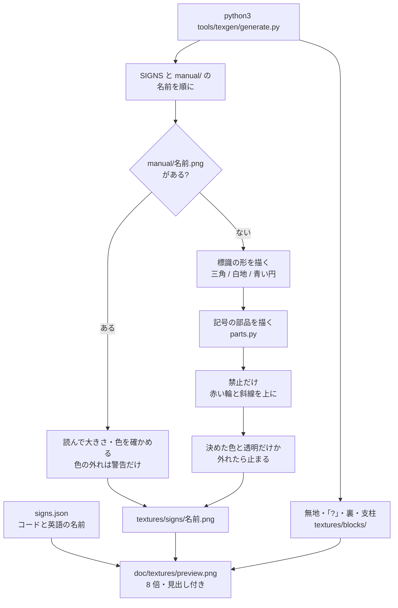

# テクスチャの生成

`tools/texgen/generate.py` が看板のテクスチャと一覧画像を作る流れ（0.6.1）。手元で流して、出力の PNG をコミットする（ビルドには Python を持ち込まない）。仕組みを変えたら、同じ PR でこの図を直す。

- 図柄は `SIGNS` に「標識の形（`warning` / `prohibition` / `mandatory`）＋記号の部品（`parts.py`）」で定義する。
- `tools/texgen/manual/<名前>.png` があれば、その図柄は生成せず、手で仕上げたファイルをそのままコピーする（`SIGNS` にない名前も出力する）。
- 生成した図柄は、決めた色と透明以外のピクセルがあれば止まる。手で仕上げた図柄は警告だけ出して使う（32×32 でなければ止まる）。
- 一覧画像の見出し（コードと英語の名前）は、jar に入る定義ファイル `signs.json` から読む。

